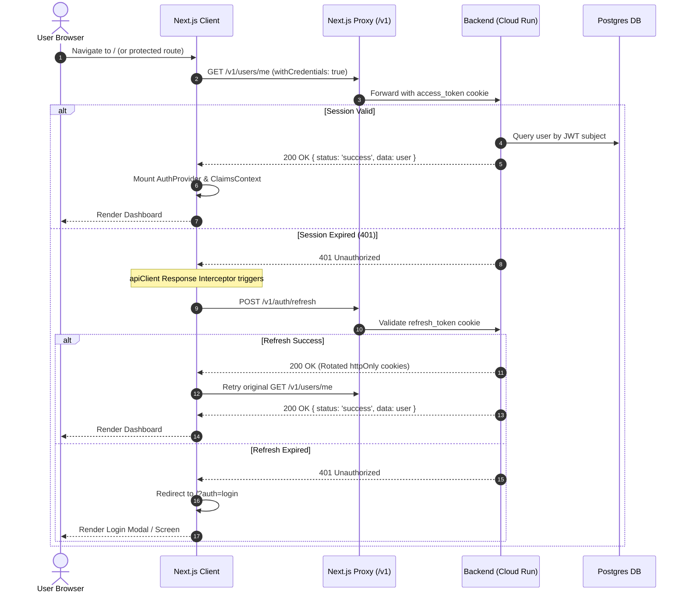

# AlphaDraft Application Lifecycle & User Flows

This document details user journey paths, route transitions, authentication gates, and editor auto-save states.

---

## 1. Authentication & Session Flow



---

## 2. Project Creation & Document Analysis Flow

```mermaid
flowchart TD
    Start([User Clicks 'Create Project']) --> Step1[Step 1: Project Metadata\nName, Type, Description, Due Date]
    Step1 --> SaveV1[API: POST /v1/projects\nPayload: CreateProjectDto]
    SaveV1 --> Step2[Step 2: Upload or Input Assignment Instructions]
    Step2 --> AnalyzeInstr[API: POST /v1/projects/:id/instructions/analyze\nPayload: { textContent }]
    AnalyzeInstr --> Step3[Step 3: Document Upload or Start Blank Draft]
    Step3 --> Editor[Redirect to /dashboard/projects/draft/:projectId\nMount TipTap Editor]
    
    Editor --> AutoSave{User Types in Editor}
    AutoSave -- Debounce 1.5s --> V2Save[API: PUT /v2/projects/:id\nPayload: { content, name }]
    V2Save --> Snapshot[Local Session Snapshot Saved]

    Editor --> TriggerAI[User Triggers AI Detection / Plagiarism]
    TriggerAI --> CreditCheck{Check Credit Balance}
    CreditCheck -- Insufficient --> UpgradeModal[Display GatePricing / Top-Up Modal]
    CreditCheck -- Sufficient --> DeductCredit[API: POST /v1/credits/deduct]
    DeductCredit --> RunProxy[API: /api/v1/winston/* or /api/v1/sapling/*]
    RunProxy --> Highlight[Render AIHighlight and Tooltip Annotations]
```

---

## 3. Route Access Matrix & Guards

| Route Pattern | Protection Level | Guard / Context | Redirection on Failure |
| :--- | :--- | :--- | :--- |
| `/` | Public | None | N/A |
| `/privacy`, `/terms` | Public | None | N/A |
| `/?auth=login`, `/?auth=signup` | Guest / Public | Modal overlays on public layout | Redirect to `/dashboard` if already authed |
| `/auth/reset-password` | Public with token | Password reset token validation | Redirect to `/` |
| `/dashboard` | Protected (`user`) | `useAuthGuard()` | `/?auth=login&redirect=/dashboard` |
| `/dashboard/projects` | Protected (`user`) | `useAuthGuard()` | `/?auth=login&redirect=/dashboard/projects` |
| `/dashboard/projects/draft/[projectId]` | Protected (`user`) | `useAuthGuard()`, `useProject()` | `/?auth=login` or `/dashboard/projects` |
| `/dashboard/settings` | Protected (`user`) | `useAuthGuard()` | `/?auth=login` |
| `/unauthorised` | Public Fallback | Renders 403 Forbidden feedback | Links back to dashboard or home |

---

## 4. TipTap Auto-Save & Debounce Pipeline
1. **Editor Change Listener:** Every keystroke invokes `editor.on('update')`.
2. **Debounce Queue:** Updates are passed through `useDebounce(content, 1500)`.
3. **Session Snapshot:** Before each remote sync, `sessionStorage.setItem('editor-snapshots-<id>', ...)` maintains up to 5 undo/recovery snapshots.
4. **Backend Sync:** Dispatches `PUT /v2/projects/:id` using `apiClient`.
5. **State Feedback:** Top bar displays `Saving...` $\rightarrow$ `Saved` with timestamp indicators.
