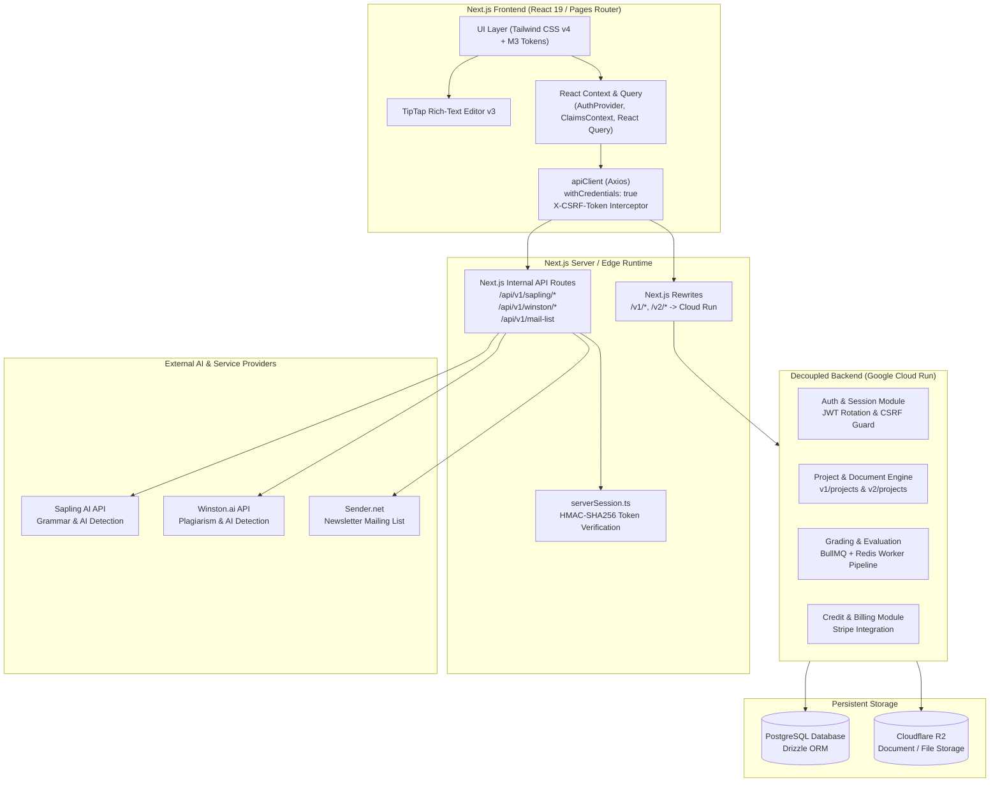

# AlphaDraft Architecture & Technical Overview

## 1. Executive Summary

**AlphaDraft** is a Next.js (Pages Router v15.4 / React 19 / Tailwind CSS v4) academic and professional writing intelligence platform. It provides document drafting, AI detection (Sapling & Winston.ai), automated document guidance/critique, citation management, and tiered credit/subscription management.

The architecture was decoupled from Firebase Client/Admin SDKs to a modern, cloud-native backend running on Google Cloud Run with PostgreSQL (Drizzle ORM), Cloudflare R2 object storage, and httpOnly cookie-based JWT authentication with CSRF double-submit protection.

---

## 2. High-Level Architecture Diagram

---

## 3. Core System Components

### 3.1 Frontend Web Application
- **Framework:** Next.js 15.4.10 (Pages Router), React 19.0.0.
- **Styling System:** Tailwind CSS v4 with Material 3 tonal surface tokens, adaptive CSS variables, and native dark mode support.
- **Document Engine:** TipTap PM v3 with custom extensions (`AIHighlight`, `EditedMark`, `StaleHighlightExtension`, and auto-saving debounce pipeline).
- **Client Cache:** TanStack React Query v5 for server data caching, revalidation, and mutation states.

### 3.2 Authentication & Security Model
- **Token Storage:** Dual httpOnly, Secure, SameSite cookies (`access_token` with 15-minute TTL, `refresh_token` with 30-day TTL).
- **CSRF Double-Submit Protection:** Non-httpOnly `csrf_token` cookie read by client and mirrored in the `X-CSRF-Token` request header for state-changing HTTP methods (`POST`, `PUT`, `PATCH`, `DELETE`).
- **Silent Refresh Interceptor:** Built into `utils/api/apiClient.ts`—on any 401 HTTP response, it buffers subsequent requests, triggers a single `POST /v1/auth/refresh`, and retries the original request seamlessly upon cookie rotation.
- **Server-Side Verification:** Next.js API routes verify the `access_token` cookie using Node's native `timingSafeEqual` and HMAC-SHA256 against `JWT_SECRET` without external dependencies.

### 3.3 Next.js API Proxy Layer
- Server-side routes act as confidential credential proxies (`/pages/api/v1/sapling/*`, `/pages/api/v1/winston/*`).
- Client requests never expose private third-party API keys (`SAPLING_API_KEY_*`, `WINSTON_API_KEY_*`, `SENDER_API_TOKEN`).
- All proxy endpoints enforce user session validation prior to dispatching requests.

### 3.4 Decoupled Cloud Run Backend
- Deployed on Google Cloud Run.
- Database access through PostgreSQL via Drizzle ORM.
- Presigned URL uploads/downloads via Cloudflare R2 bucket.
- Asynchronous grading and document analysis queues managed through Redis & BullMQ.
