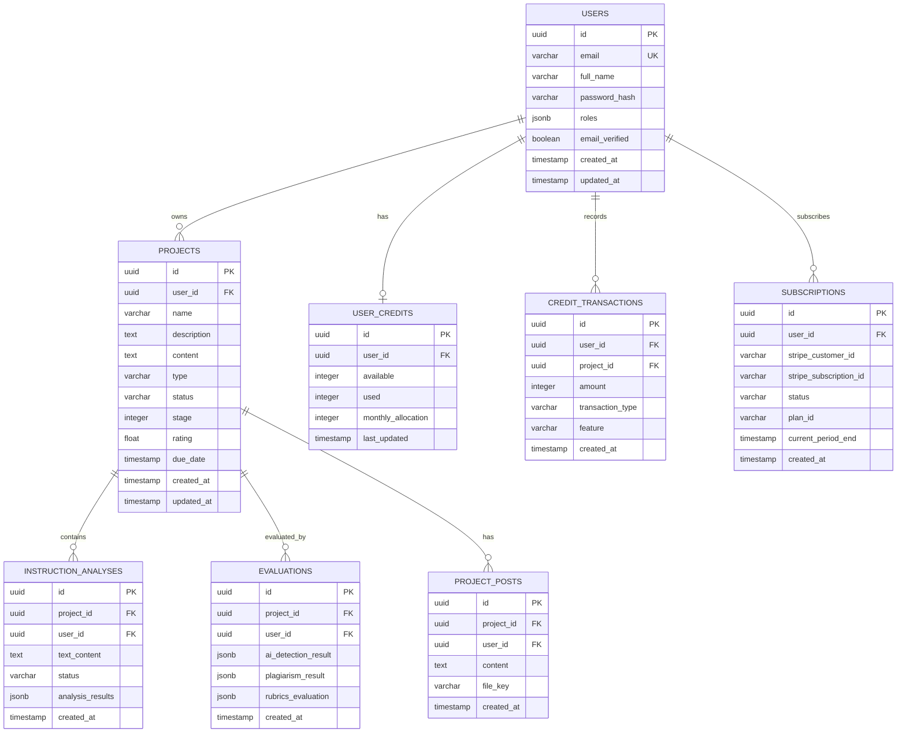

# AlphaDraft Database Schema & Entity Models

This document specifies the PostgreSQL relational schema and frontend TypeScript entity definitions following the decoupling from Firebase Firestore.

---

## 1. Entity Relationship Diagram (ERD)

---

## 2. Table Specifications & Data Dictionaries

### 2.1 `users` Table
Stores authentication accounts, role arrays, and profile identification.
| Column | Type | Constraints | Description |
| :--- | :--- | :--- | :--- |
| `id` | `UUID` | PRIMARY KEY, DEFAULT gen_random_uuid() | Unique user identifier. |
| `email` | `VARCHAR(255)` | UNIQUE, NOT NULL | Account email address. |
| `full_name` | `VARCHAR(255)` | NOT NULL | User's full display name. |
| `password_hash` | `TEXT` | NOT NULL | Argon2 / bcrypt password hash. |
| `roles` | `JSONB` | NOT NULL, DEFAULT '["user"]' | Assigned security roles (`user`, `subscriber`, `admin`, `super_admin`). |
| `email_verified`| `BOOLEAN` | DEFAULT FALSE | Email verification status flag. |
| `created_at` | `TIMESTAMPTZ` | DEFAULT NOW() | Record creation timestamp. |
| `updated_at` | `TIMESTAMPTZ` | DEFAULT NOW() | Last record update timestamp. |

### 2.2 `projects` Table
Represents user writing workspaces, instructions, and document drafts.
| Column | Type | Constraints | Description |
| :--- | :--- | :--- | :--- |
| `id` | `UUID` | PRIMARY KEY, DEFAULT gen_random_uuid() | Project identifier. |
| `user_id` | `UUID` | FOREIGN KEY (`users.id`) ON DELETE CASCADE | Project owner. |
| `name` | `VARCHAR(255)` | NOT NULL | Document/project title. |
| `description` | `TEXT` | NULLABLE | Brief context or abstract. |
| `content` | `TEXT` | NOT NULL, DEFAULT '' | Raw or HTML/ProseMirror document body. |
| `type` | `VARCHAR(64)` | NOT NULL | Project category (e.g., Essay, Research Paper, Report). |
| `status` | `VARCHAR(32)` | NOT NULL, DEFAULT 'draft' | Status (`draft`, `in_progress`, `completed`, `archived`). |
| `stage` | `INTEGER` | NOT NULL, DEFAULT 0 | Wizard progression stage (0 to 4). |
| `rating` | `FLOAT` | DEFAULT 0.0 | Overall automated evaluation score. |
| `due_date` | `TIMESTAMPTZ` | NULLABLE | Submission deadline. |
| `created_at` | `TIMESTAMPTZ` | DEFAULT NOW() | Creation timestamp. |
| `updated_at` | `TIMESTAMPTZ` | DEFAULT NOW() | Auto-updated timestamp. |

### 2.3 `user_credits` & `credit_transactions`
Handles account credit deductions and balance ledgers.
- **`user_credits`**: Tracks real-time credit capacity (`available`, `used`, `monthly_allocation`).
- **`credit_transactions`**: Audit trail of every credit movement (`DEDUCT`, `REFUND`, `TOP_UP`) tagged by feature (`AI_ONLY`, `ALIGNMENT_ONLY`, `PLAGIARISM_ONLY`).

### 2.4 `evaluations`
Stores evaluation results from AI detection and grading engines:
- **`ai_detection_result`** (`JSONB`): Winston.ai / Sapling score breakdown (`score`, `sentences`, `credits_used`).
- **`plagiarism_result`** (`JSONB`): Plagiarism percentage, source citations, matching URL indices.
- **`rubrics_evaluation`** (`JSONB`): Alignment scores against project instruction criteria.
