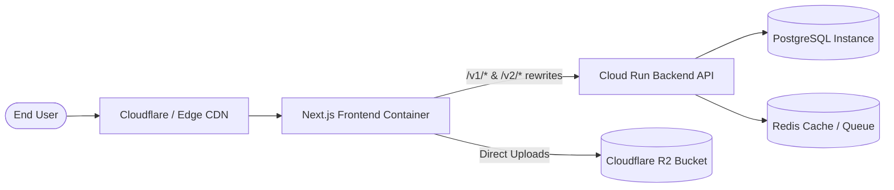

# Deployment, Environment Configuration & Operations Guide

## 1. Environment Variable Reference

Create a `.env.local` file for local development or populate your hosting environment secrets (e.g. Google Cloud Run, Vercel, Firebase App Hosting):

```bash
# ── Server & Runtime Environment ──────────────────────────────────
NODE_ENV=development
PORT=3000

# ── Decoupled Backend URL ──────────────────────────────────────────
# Server-side destination used by Next.js rewrites to proxy /v1 and /v2
BACKEND_URL=https://alpha-drafts-backend-dev-635966690380.us-east1.run.app

# Client-side backend URLs (when not using rewrites directly)
NEXT_PUBLIC_LOCAL_URL=http://localhost:8080
NEXT_PUBLIC_DEVELOPMENT_URL=https://alpha-drafts-backend-dev-635966690380.us-east1.run.app
NEXT_PUBLIC_STAGING_URL=https://alpha-drafts-backend-dev-635966690380.us-east1.run.app

# ── JWT Server Secret (DO NOT PREFIX WITH NEXT_PUBLIC_) ─────────────
# Used by Next.js API routes (utils/auth/serverSession.ts) to verify access_token cookies
JWT_SECRET=your-shared-hs256-jwt-secret-matching-backend

# ── Cloudflare R2 Storage (Document & File Uploads) ─────────────────
R2_PUBLIC_URL=https://pub-xxxxxx.r2.dev

# ── AI Detection & Grammar Engines (Server-side keys) ───────────────
SAPLING_API_KEY_DEV=your_sapling_dev_key
SAPLING_API_KEY_PROD=your_sapling_prod_key

WINSTON_API_KEY_DEV=your_winston_dev_key
WINSTON_API_KEY_PROD=your_winston_prod_key

# ── Newsletter Integration (Sender.net) ─────────────────────────────
SENDER_API_TOKEN=your_sender_api_token
SENDER_NEW_USERS_GROUP=your_sender_group_id

# ── Mock Mode (Development offline testing) ─────────────────────────
NEXT_PUBLIC_MOCK_MODE=false
```

---

## 2. Local Setup & Execution

### 2.1 Prerequisites
- Node.js `20.x` or later
- Yarn `1.22.x` (or npm)

### 2.2 Installation & Build Commands
```bash
# Install dependencies
yarn install

# Type-check TypeScript codebase
yarn check-types

# Run ESLint validation
yarn lint

# Start development server (localhost:3000)
yarn dev

# Production build
yarn build

# Run Playwright E2E tests
yarn test
```

---

## 3. Deployment Topology



### Key Deployment Considerations
1. **Cookie Configuration:** The backend sets cookies with `SameSite=Lax` and `Secure=true`. The frontend domain and backend domain must share the same parent root domain or be unified via Next.js rewrites to prevent browser third-party cookie blocking.
2. **Reverse Proxy / Rewrites:** [next.config.ts](file:///Users/saifyusuph/Documents/Visionary%20Insights/alhpadraft-new/next.config.ts) routes `/v1/:path*` and `/v2/:path*` to `process.env.BACKEND_URL`. Ensure `BACKEND_URL` is set in the hosting container.
